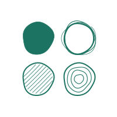

<p align="center">
  <picture>
    <source media="(prefers-color-scheme: dark)" srcset="assets/moku-icon-dark.svg">
    <source media="(prefers-color-scheme: light)" srcset="assets/moku-icon-light.svg">
    
  </picture>
</p>

<h1 align="center">moku</h1>

<p align="center">a little forest of marimo clients</p>

## About

moku is a development playground for building marimo clients entirely on the [host protocol](https://github.com/marimo-team/marimo/blob/main/protocols/host/README.md). The code is **experimental and not for production use**. Examples:

- [**Notebook**](apps/@moku-launcher/src/plugins/notebook/) — a notebook editor with interactive outputs.
- [**Graph explainer**](apps/@moku-launcher/src/plugins/graph-explainer/) — a view of cell dependencies and execution.

The clients share connections, notebook state, editing, and output rendering through the [packages](packages/).

A plugin can be as small as a live cell count:

```tsx
import { Plugin } from "@moku/plugin";
import { useAtomValue } from "@effect/atom-react";

export default Plugin.define({
  id: "cell-count",
  effect: (ctx) =>
    ctx.view.add({
      id: "count",
      title: "Cell count",
      render: ({ notebook }) => {
        const count = useAtomValue(
          notebook.state,
          (state) => Object.keys(state.value.cells).length,
        );
        return <p>{count} cells</p>;
      },
    }),
});
```

For a complete example, [Basic](apps/@moku-launcher/src/plugins/basic/) lets you pick, edit, and run one cell alongside its output.

## Getting started

Requires Bun, Git, uv, and the pnpm version used by the selected marimo checkout.

```sh
bun setup
bun dev
```

Open the authenticated link printed in the terminal.

## Tinker

Add a view with [@moku/plugin](packages/@moku-plugin/README.md) and register it in [plugins.ts](apps/@moku-launcher/src/plugins.ts).
